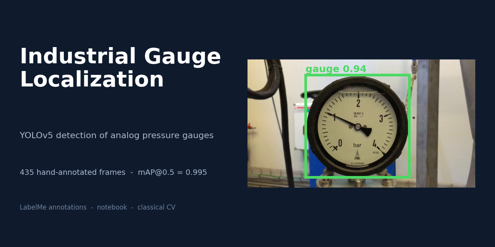
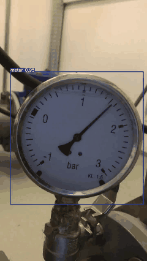
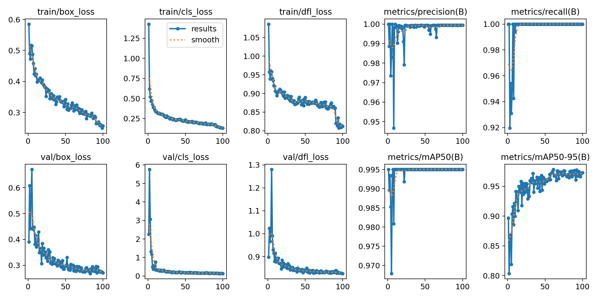
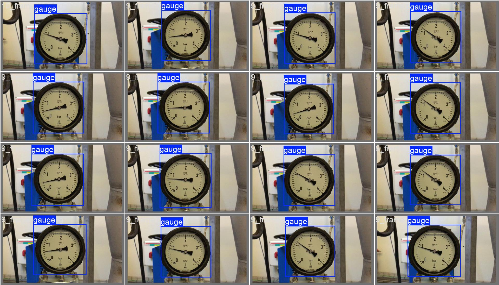
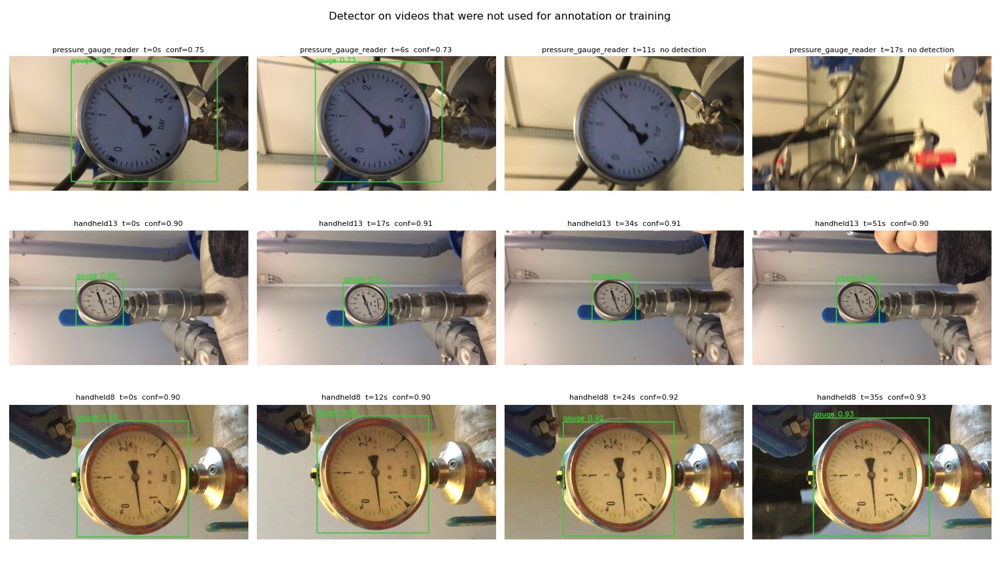
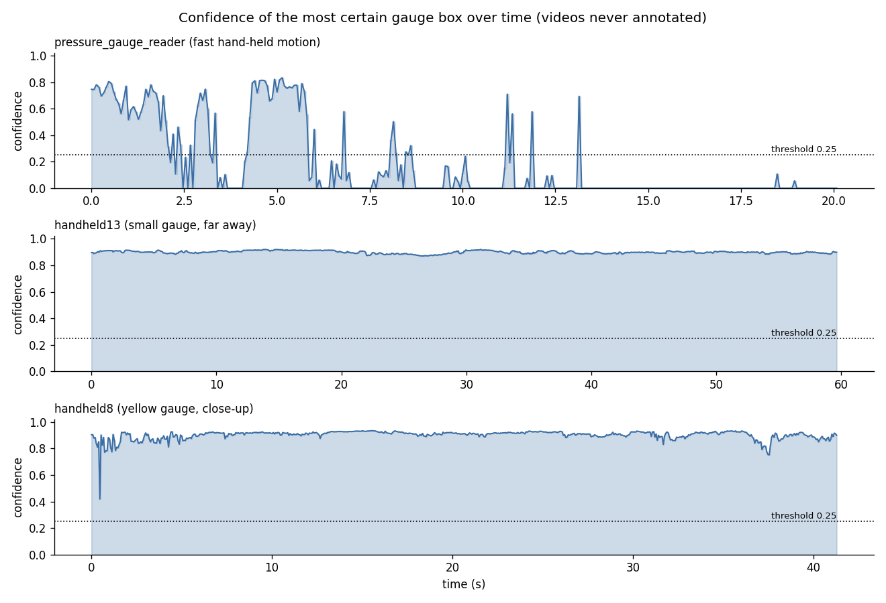
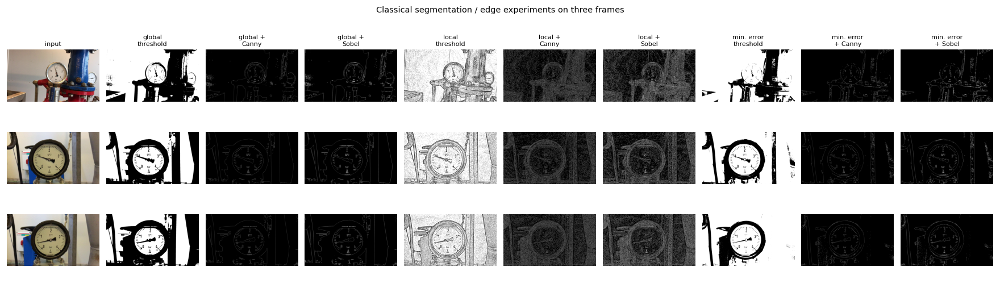

<p align="center"></p>

<h1 align="center">Industrial Gauge Localization</h1>

<p align="center">
Finding an analog pressure gauge in video frames with YOLOv5 - a hand-annotated dataset,<br>
the training pipeline and the first stage of automatic gauge reading.
</p>

<p align="center">
  
  
  
  
</p>

<p align="center"></p>
<p align="center"><sub>The detector running on a video (full 20 s clip: <a href="results/demo/yolo_detection_result.mp4"><code>results/demo/yolo_detection_result.mp4</code></a>)</sub></p>

> Work done between **August 2024 and April 2025**.

---

## At a glance

| | |
|---|---|
| **Goal** | Read analog gauges automatically. The first step is to find the gauge in the frame, so that the dial can be cropped and rectified before the needle is read. |
| **Data** | 435 frames (1920x1080) from three recordings of pressure gauges, **annotated by hand twice** with LabelMe, plus 435 augmented frames |
| **Model** | YOLOv5s (ultralytics), 100 epochs, batch 16, 640 px, one class |
| **Result** | **mAP@0.5 = 0.995**, **mAP@0.5:0.95 = 0.978**, precision 0.999, recall 1.0 (87 validation frames); 100 % of the frames of two never-annotated videos detected |
| **Speed** | about 15 FPS on a laptop GPU (RTX 3050), 2 FPS on CPU; ONNX export included |
| **Also here** | Classical image-processing experiments: global / local / minimum-error thresholding with Canny and Sobel, perspective correction, white balance |

## Results

Training curves of the YOLOv5s run (100 epochs, 348 training and 87 validation frames):

<p align="center"></p>

| Metric (best epoch, 61) | Value |
|---|---|
| Precision | 0.9994 |
| Recall | 1.0000 |
| mAP@0.5 | 0.995 |
| mAP@0.5:0.95 | 0.978 |

Predictions on validation frames (left: annotation, right: prediction):

<p align="center">
  
  
</p>

More curves and the confusion matrix are in [`results/yolo_training`](results/yolo_training). The trained weights are [`models/best.pt`](models/best.pt) (18.5 MB) and the ONNX export [`models/best.onnx`](models/best.onnx) (36.7 MB). Details, speed and limits: [`docs/model_card.md`](docs/model_card.md).

## Detection on videos that were never annotated

The detector was also run on three recordings that were **not used for annotation or training** (every second frame, confidence threshold 0.25). Clips with the boxes drawn are in [`results/demo/unseen_videos`](results/demo/unseen_videos).

<p align="center"></p>

| Video | Length | Frames with a detection | Mean confidence |
|---|---|---|---|
| `handheld13` (small gauge, far away) | 60 s | **100 %** | 0.90 |
| `handheld8` (yellow gauge, close-up) | 41 s | **100 %** | 0.90 |
| `Pressure Gauge Reader` (fast hand-held motion) | 20 s | 27 % | 0.63 |

<p align="center"></p>

The two steady recordings are detected in every frame. In the third video the gauge is found while it is sharp and in view (first seconds); it is missed when the camera moves fast and the image blurs or the gauge leaves the frame.

## The dataset

* **435 frames** taken from three recordings (a far view among pipes, a hand-held close-up and a fixed view of a second gauge), 1920x1080, in [`data/images`](data/images). YOLO labels (one box per frame, class `0 = gauge`) are in [`data/labels`](data/labels).
* **435 augmented frames** in [`data/augmented`](data/augmented).
* The gauge covers 10 % to 48 % of the frame depending on the video.

<p align="center">
  
</p>

Details of every folder and column: [`data/README.md`](data/README.md).

## Annotations (made by hand with LabelMe)

All boxes were drawn by the author with **LabelMe 5.5.0**, in three versions kept side by side in [`annotations/`](annotations):

| Folder | Content |
|---|---|
| `labelme_pass1_2024` | First pass, used to create the YOLO labels |
| `labelme_pass2_2025` | Second, independent pass over the same 435 frames |
| `quad_4point_2025` | The second pass as four corner points (for perspective rectification) |
| `labelme_augmented_2025` | Annotations of the 435 augmented frames |

The two passes have a mean IoU of 0.845, which is the level at which two careful annotations of the same frame agree. Full description, file format and how to open the files in LabelMe: [`annotations/README.md`](annotations/README.md).

<p align="center"></p>

## Classical image-processing experiments

Before using a neural network, thresholding and edge-detection methods were tried on five frames: global, local (adaptive) and minimum-error thresholding, each alone, with Canny and with Sobel; and a perspective correction and a white-balance step (scripts in [`src/classical_cv`](src/classical_cv), outputs in [`results/classical_cv`](results/classical_cv)).

<p align="center"></p>

## Pipeline

```
recordings -> frame extraction -> LabelMe annotation -> YOLO labels -> train / val split -> YOLOv5s training -> gauge boxes
```

The steps are described in [`docs/pipeline.md`](docs/pipeline.md); the model and the data have a [model card](docs/model_card.md) and a [dataset card](docs/dataset_card.md); the checks made on the data are in [`docs/data_audit.md`](docs/data_audit.md); what comes next is in [`docs/roadmap.md`](docs/roadmap.md); papers read for the project are listed in [`docs/literature.md`](docs/literature.md), with the author's summaries (Persian) in [`docs/literature_notes`](docs/literature_notes).

## Repository structure

```
.
├── src/                              # the author's code, by pipeline stage
│   ├── data_preparation/             # frame extraction, json -> YOLO, train/val split, label fix
│   ├── augmentation/                 # image augmentation (albumentations)
│   ├── annotation/                   # rectangle -> four corner points
│   ├── classical_cv/                 # thresholding, Canny, Sobel, perspective, white balance
│   └── README.md
├── notebooks/                        # the original Colab notebook (training)
├── configs/data.yaml                 # dataset description used by the YOLO training
├── models/best.pt  best.onnx         # trained YOLOv5s weights (PyTorch and ONNX)
├── data/
│   ├── images/video_07..10/          # 435 labelled frames
│   ├── labels/video_07..10/          # YOLO labels
│   ├── augmented/images/             # 435 augmented frames
│   ├── frames.csv                    # frame -> video -> source recording
│   └── README.md
├── annotations/                      # hand-made LabelMe annotations (+ README)
│   ├── labelme_pass1_2024/  labelme_pass2_2025/  quad_4point_2025/  labelme_augmented_2025/
├── results/
│   ├── demo/                         # result video + GIF
│   ├── yolo_training/                # curves, matrices, predictions
│   ├── figures/  tables/             # data analysis
│   └── classical_cv/                 # outputs of the classical experiments
├── docs/                             # model card, dataset card, pipeline, data audit, roadmap, literature
│   └── banner.png
└── .env.example   CITATION.cff   LICENSE   requirements.txt
```

## Use it

```bash
git clone https://github.com/ftharir/industrial-gauge-localization.git
cd industrial-gauge-localization
pip install -r requirements.txt
```

```python
from ultralytics import YOLO

model = YOLO("models/best.pt")
results = model.predict("data/images/video_09/9_frame (22).jpg", conf=0.25)
print(results[0].boxes.xyxy)          # box of the gauge in pixels
```

The scripts in `src` read their input and output folders from a `.env` file: copy `.env.example` to `.env` and set the folders (details in [`src/README.md`](src/README.md)).

## License and data

The code, annotations, documentation and figures are released under the [MIT licence](LICENSE).
The three source recordings (540 MB) are not part of the repository because of their size; the frames in `data/images` were taken from them.
To cite this work, see [`CITATION.cff`](CITATION.cff).
