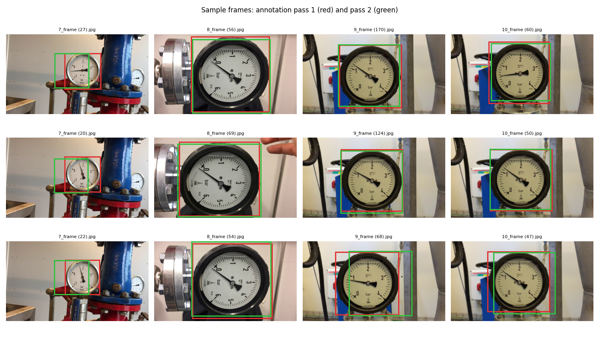

# Annotations

All annotations in this folder were drawn **by the author, by hand, with [LabelMe](https://github.com/wkentaro/labelme) 5.5.0**, on the 435 video frames in [`../data/images`](../data/images). Nothing here was produced by a model or by an automatic labelling tool.

The task is to mark the **pressure gauge** in every frame: one object per frame, one rectangle around the gauge.

## Contents

| Folder | Annotation | Period | Label in the file | Points per shape |
|---|---|---|---|---|
| [`labelme_pass1_2024/`](labelme_pass1_2024) | First pass, used to train the detector | 29 Aug - 2 Sep 2024 | `meter` | 2 (opposite corners) |
| [`labelme_pass2_2025/`](labelme_pass2_2025) | Second, independent pass over the same frames | 27-28 Mar 2025 | `Panel` | 2 (opposite corners) |
| [`quad_4point_2025/`](quad_4point_2025) | Pass 2 rewritten with four corner points | 21 Apr 2025 | `Panel` | 4 |
| [`labelme_augmented_2025/`](labelme_augmented_2025) | Boxes of the 435 augmented frames (copies of the original boxes, see below) | 2025 | `Panel` | 2 (opposite corners) |

Every folder has one sub-folder per video (`video_07`, `video_08`, `video_09`, `video_10`) and one `.json` per frame with the same name as the frame, so `labelme_pass1_2024/video_09/9_frame (22).json` belongs to `../data/images/video_09/9_frame (22).jpg`.
435 files per folder: 30 + 75 + 260 + 70.

**Augmented frames:** the images in `../data/augmented/images` were made with `src/augmentation/augment_images.py`, which changes only the images. Their annotation files repeat the boxes of the original frames, so they are exact for frames that were only brightened or given noise and approximate for mirrored or rotated ones.

## Opening them in LabelMe

```bash
pip install labelme==5.5.0
labelme "annotations/labelme_pass1_2024/video_09/9_frame (22).json"
```

Each file points to its image with a relative path (`../../../data/images/video_09/9_frame (22).jpg`), so LabelMe finds the frame as long as the repository layout is kept. To browse a whole folder: `labelme annotations/labelme_pass2_2025/video_09`.

## File format

Standard LabelMe JSON:

```json
{
  "version": "5.5.0",
  "shapes": [
    {"label": "Panel", "points": [[568.4, 1025.3], [1507.9, 90.8]], "shape_type": "rectangle", "group_id": null, "flags": {}}
  ],
  "imagePath": "../../../data/images/video_10/10_frame (1).jpg",
  "imageData": null,
  "imageHeight": 1080,
  "imageWidth": 1920
}
```

* `points` are pixel coordinates `(x, y)` with the origin at the top-left corner; a two-point rectangle stores two opposite corners (in any order).
* In the quad files the four points are, in order, top-left, bottom-left, bottom-right, top-right. They are written with `shape_type: "rectangle"`, which LabelMe draws as the bounding box of the points; the file is meant for code that reads the four corners (for example perspective rectification), not for editing in LabelMe.

### Two changes made for the repository

1. **`imageData` is `null`.** LabelMe embeds the whole frame as base64 in each file (about 190-380 KB per file, 80-160 MB per pass). The frame is already in `data/images`, so it was removed; the annotation geometry is untouched.
2. **`imagePath` was rewritten** to the relative path of the frame (in some originals it was a temporary name such as `frame_0.jpg`).

## How the training labels were made

The YOLO text labels in [`../data/labels`](../data/labels) were generated from **pass 1**:

1. `src/data_preparation/json_to_yolo.py` turns the two corner points into `label x_center y_center width height`, normalised by the image size (1920x1080);
2. `src/data_preparation/fix_label_class_names.py` replaces the label name `meter` by the class id `0`.

The YOLO files and the pass-1 JSON describe the same boxes (checked on the whole set: IoU > 0.999).

## Quality of the annotations

The same frames were annotated twice, months apart, which allows a check of the annotation itself:

| | Pass 1 | Pass 2 |
|---|---|---|
| Mean box size (px) | 846 x 837 | 842 x 835 |
| Mean share of the frame | 34.8 % | 34.6 % |

* The **size** of the boxes is practically the same in both passes, but the **position** differs: the box centres are on average **62 px** apart (median 49 px) and the mean IoU between the two boxes is **0.845**; 35 % of the frames are below 0.8.
* The two passes therefore disagree mostly by a small shift of the rectangle, not by drawing a different object. For a detector, an IoU of about 0.85 against one pass is already at the level at which two careful annotations of the same frame agree.
* Video 7 (gauge far away, 10 % of the frame) has the lowest agreement (IoU 0.71) because a few pixels of shift weigh more on a small box; video 8, 9 and 10 are at 0.85 - 0.86.


Sample frames with both passes (pass 1 red, pass 2 green):



## Limits and notes

* One class and one box per frame; there is no annotation of the needle, the scale or the numbers yet, so this set supports **gauge detection and perspective rectification**, not yet reading the value.
* The label names differ between passes (`meter` and `Panel`) because they were made at different times; both mean the same object (the gauge).
* The frames come from only three recordings, so the annotations cover few scenes (see [`../data/README.md`](../data/README.md)).
* Annotations by other people are not part of this repository.

## License

The annotations are released under the repository's MIT licence together with the code; the frames come from the author's own recordings.
