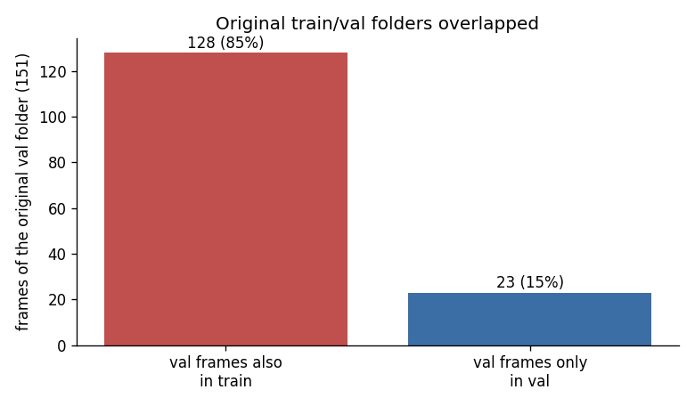
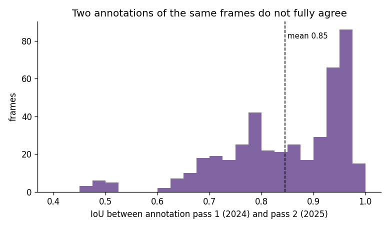
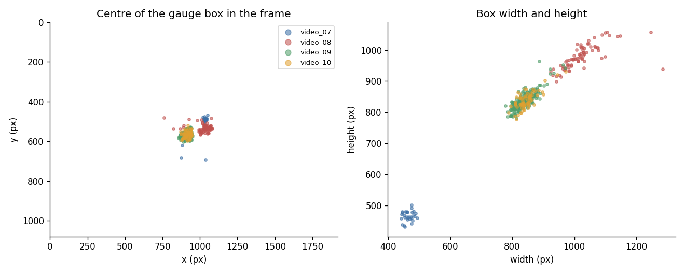

# Data audit

Checks made on the labelled frames before training.

## 1. The original train/val folders overlapped

The first dataset (`dataset/images/train|val`) contained 412 training and 151 validation images, but only **435 distinct frames**.
**128 of the 151 validation frames (85 %) were also in the training folder**, so the validation scores of that dataset were measured mostly on frames the model had trained on.
The most likely cause is that `create_train_val_split.py` was run more than once into the same output folder (every run adds a new random split), which is easy to do.

Consequence: this repository does not use that folder. The training run uses a fresh split made once with `create_train_val_split.py`: 348 training and 87 validation frames, no frame in both.

## 2. Neighbouring frames are almost identical

Frames are taken from continuous video, so a random 80/20 split puts near-duplicates of the training frames into validation. The validation scores therefore describe frames from the same recordings; recordings that are new to the model (for example the unlabelled videos) are the real test of generalisation.

## 3. The two annotation passes disagree by about 15 %

The same 435 frames were annotated twice, in 2024 and in 2025, with LabelMe rectangles. The mean IoU between the two boxes is **0.845**; 35 % of the frames are below 0.8 (`results/tables/frame_statistics.csv`).
Both are plausible outlines of the gauge (they differ in how much of the housing and the mounting is included), so a detector cannot be expected to reach IoU 1.0 against either of them.

## 4. Data properties

* one object per frame, one class (`gauge`), all frames 1920x1080;
* the gauge covers 10 % (video 7) to 48 % (video 8) of the frame, see `results/tables/per_video_summary.csv`;
* three different scenes: a far view among pipes (video 7), a close hand-held view (video 8) and a fixed view of a second gauge (videos 9 and 10).

