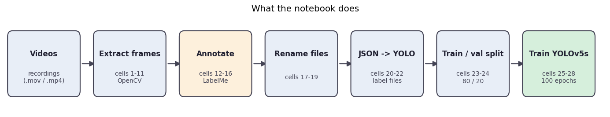

# Notebooks

<p align="center"></p>

## `01_yolov5_gauge_detection_pipeline.ipynb`

The author's Colab notebook (August 2024) that takes a video all the way to a trained YOLOv5 gauge detector. It is the **main code of the project**.

| Step | Cells | What happens | Same step as a script in `../src` |
|---|---|---|---|
| 1. Frame extraction | 1-11 | `extract_frames()` takes evenly spaced frames from each video with OpenCV | `data_preparation/extract_frames.py` |
| 2. Annotation | 12-16 | frames are labelled by hand in LabelMe (one rectangle around the gauge); a sample of frames is displayed | - (LabelMe, see [`../annotations`](../annotations)) |
| 3. Renaming | 17-19 | files get the video number as a prefix so frames of different videos do not collide | - |
| 4. Label conversion | 20-22 | `convert_json_to_yolo()` turns the LabelMe rectangles into YOLO text labels | `data_preparation/json_to_yolo.py` |
| 5. Dataset | 23-24 | random 80 / 20 split into `dataset/images|labels/train|val` | `data_preparation/create_train_val_split.py` |
| 6. **Training YOLO** | **25-28** | **YOLOv5s fine-tuned for 100 epochs** | - |

### The YOLO code (cells 26-28)

```python
from ultralytics import YOLO

YV5_model = YOLO("yolov5s.pt")
YV5_model.train(data="./dataset/data.yaml", epochs=100, batch=16, imgsz=640)
```

`data.yaml` describes the dataset (one class, `gauge`); a ready file is in [`../configs/data.yaml`](../configs/data.yaml).

## Results saved in the notebook

The outputs of the training cells (26-28) come from a run of this code on the frames in [`../data`](../data) (348 training and 87 validation frames, 100 epochs): the training log, the validation table per epoch and the final summary.
The plots, confusion matrices and predictions of the same run are in [`../results/yolo_training`](../results/yolo_training) and the weights in [`../models/best.pt`](../models/best.pt).

| Metric (best epoch) | Value |
|---|---|
| Precision | 0.999 |
| Recall | 1.000 |
| mAP@0.5 | 0.995 |
| mAP@0.5:0.95 | 0.978 |

The cells before training have no saved output: they need the original recordings and folders (`Videos/...`, `frames/...`), which are not in this repository.

## Running it

1. In Colab or locally with a GPU: `pip install -U ultralytics labelme opencv-python matplotlib`.
2. Put the videos into `Videos/`, run cells 1-11, annotate the frames with `labelme`, then run the rest.
3. Or skip steps 1-5 and train on the frames of this repository: build `dataset/` with `../src/data_preparation/create_train_val_split.py`, copy `../configs/data.yaml` next to it and run cells 26-28.

On Windows, a limited paging file can make the default eight data-loader processes fail; adding `workers=2` to the `train(...)` call (or lowering the default) avoids this.

## Notes

* Markdown headings and comments are in English; some variable names follow the original notebook.
* The notebook was written for the first set of recordings (frame folders `1` to `6`); the frames in this repository (`video_07` - `video_10`) went through the same steps with the scripts in [`../src/data_preparation`](../src/data_preparation).
